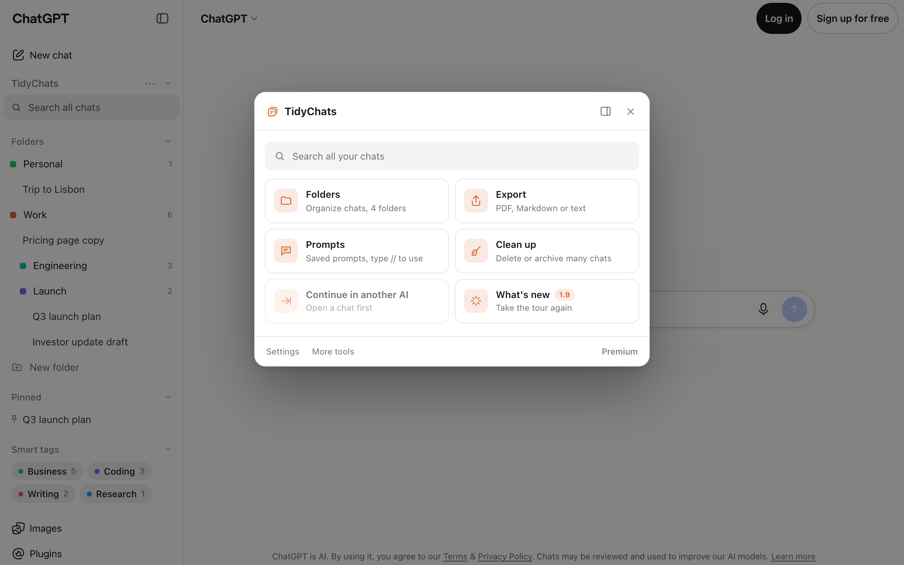
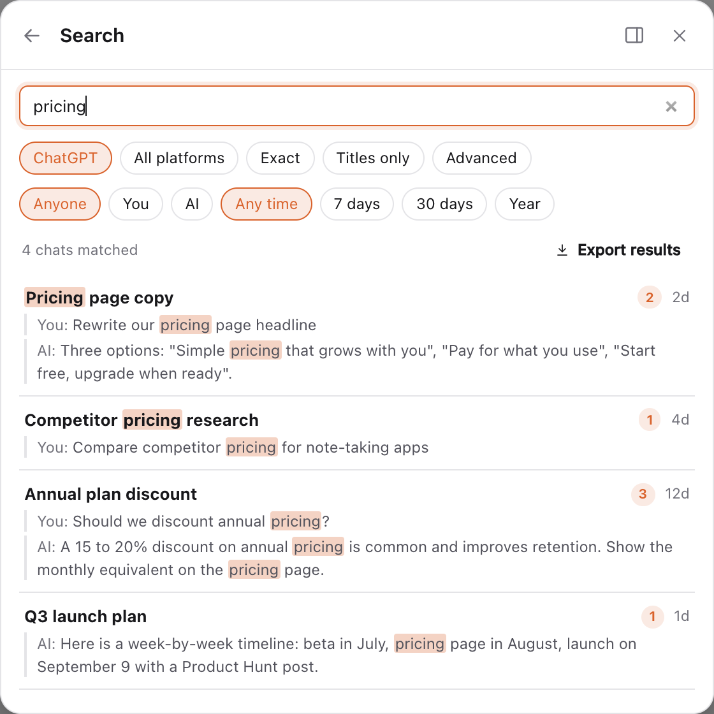
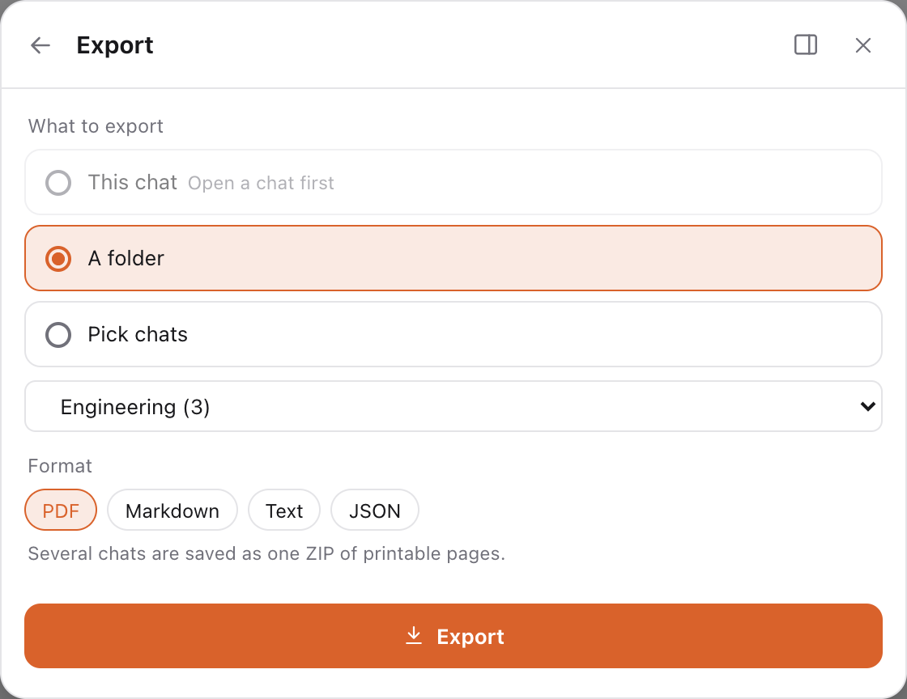
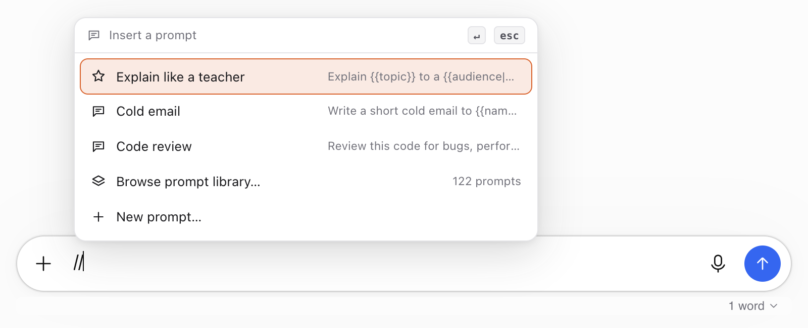
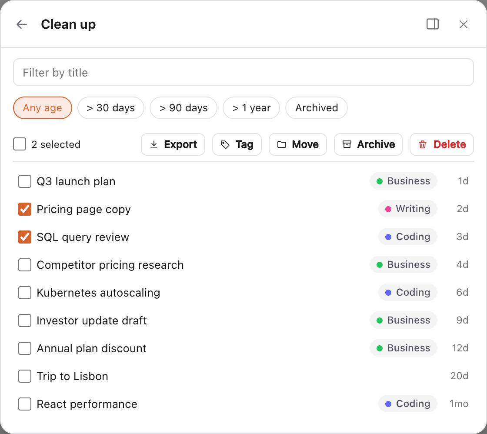

  

<h1 align="center">TidyChats: ChatGPT folders, search & export</h1>

  <strong>A free Chrome extension that adds folders, full-text search, export and bulk delete to ChatGPT, Claude, Gemini and Grok.</strong> 
  Your conversations stay in your browser. No account needed.

  <a href="https://chromewebstore.google.com/detail/tidychats-folders-search/kpbddekbghojigfgmdojcpjgoljjjhak?utm_source=github&utm_medium=readme"><b>Add to Chrome (free)</b></a> ·
  <a href="https://tidychats.com/?utm_source=github&utm_medium=readme">Website</a> ·
  <a href="https://tidychats.com/tutorials?utm_source=github&utm_medium=readme">Tutorials</a> ·
  <a href="https://github.com/mastershaig/tidychats/issues">Report a bug / request a feature</a>

  

---

## Why TidyChats

ChatGPT gives you a long list of chats and not much else. After a few months you have hundreds of conversations, no folders, a search that misses things, and no way to save a single chat as a clean PDF or Markdown file. Claude, Gemini and Grok have the same gaps.

TidyChats adds what's missing, right inside each AI's own sidebar:

- **Folders for ChatGPT, Claude, Gemini and Grok.** Unlimited folders and subfolders with colors and pins. Drag chats in, or use "Add to folder" from a chat's menu.
- **Search every message, not just titles.** Full-text search across your whole history, filtered by date or by who said it. Includes chats inside ChatGPT Projects.
- **Export any chat.** PDF, Markdown (with frontmatter for Obsidian), TXT, JSON or Word. One-click Export button next to Share on ChatGPT.
- **Bulk delete and archive.** Clean up hundreds of old ChatGPT or Claude chats at once, with a preview and a 10-second undo.
- **Prompt library.** Save prompts with `{{variables}}` and insert them by typing `//`. Comes with 120+ ready-made prompts. Chain several steps with `..`.
- **Bring a past chat into a new one.** Type `@@` to add an earlier conversation as context, or continue a long chat in a fresh one, even on another AI.

All of the above is **free with no limits**: unlimited folders, unlimited search results, every export format, unlimited saved prompts.

## Features

| | |
|---|---|
|  | **Search all your AI chats.** Find that one answer from three months ago by any word in it. Jump straight to the message. Premium searches ChatGPT, Claude, Gemini and Grok at once. |
|  | **Export ChatGPT, Claude, Gemini and Grok chats.** Save one conversation as PDF, Markdown, TXT, JSON or Word for free. Premium exports whole folders or many chats as a ZIP. |
|  | **Prompts you can reuse.** Type `//` in the chat box to insert a saved prompt, fill in its variables, send. |
|  | **Clean up in bulk.** Select many chats, see exactly what will be removed, then delete or archive. Undo within 10 seconds. |

**More:** pinned chats, smart tags (Coding, Writing, Research…), message bookmarks with notes, message labels, a command palette (`Ctrl/Cmd+K`), an outline and timestamps for long chats, find in chat, a meter that shows how full the chat's memory is, an "answer ready" signal when a reply finishes in a background tab, a media gallery for generated images, and Claude usage limits at a glance.

**Per AI:** ChatGPT audio download and one-click import of your ChatGPT data export · Claude artifact vault · Gemini with several Google accounts · Grok on grok.com and x.com/i/grok.

## Free vs Premium

| | Free | Premium |
|---|---|---|
| Folders, subfolders, pins | Unlimited | Unlimited |
| Full-text search (the AI you're using) | Unlimited results | Unlimited results |
| Search all four AIs at once | | ✓ |
| Export one chat (PDF, Markdown, TXT, JSON, Word) | ✓ | ✓ |
| Export folders / many chats as ZIP | | ✓ |
| Bulk delete and archive | Unlimited | Unlimited |
| Saved prompts | Unlimited | Unlimited |
| Prompt chains | 1 | Unlimited |
| `@@` past chats from other AIs | | ✓ |
| Sync between browsers, AI summaries | | ✓ |

**Premium is one plan for all four AIs:** $6.99/month, $49/year or $99 lifetime. 14-day money-back guarantee. [See pricing](https://tidychats.com/pricing?utm_source=github&utm_medium=readme).

## Privacy

TidyChats is local-first:

- Conversation content and the search index are stored **only in your browser** (IndexedDB).
- Free features work **without an account**.
- With Premium sync, only what you create (folders, prompts, chains, tags, bookmarks, settings) syncs between your browsers, encrypted at rest. Never your conversations.
- AI summaries (Premium) send only the chat you choose, only when you ask.
- Anonymous feature-usage counts (never chats, titles or searches) can be turned off in Settings.

Full details: [privacy policy](https://tidychats.com/privacy?utm_source=github&utm_medium=readme).

## Install

1. Open TidyChats on the [Chrome Web Store](https://chromewebstore.google.com/detail/tidychats-folders-search/kpbddekbghojigfgmdojcpjgoljjjhak?utm_source=github&utm_medium=readme) and click **Add to Chrome**.
2. Open [chatgpt.com](https://chatgpt.com), [claude.ai](https://claude.ai), [gemini.google.com](https://gemini.google.com) or [grok.com](https://grok.com).
3. TidyChats appears in the sidebar. A one-minute tour shows you around.

Works in Google Chrome and other Chromium browsers that install from the Chrome Web Store, such as Microsoft Edge, Brave and Arc.

**Moving from AI Toolbox?** Export a backup from AI Toolbox and import it in TidyChats (Settings → Import & backup). Your folders, prompts, chains and pins come over.

## Compare

- [TidyChats vs AI Toolbox](https://tidychats.com/compare/ai-toolbox?utm_source=github&utm_medium=readme): unlimited free folders and search vs a 2-folder free tier; one plan for all four AIs instead of per-AI pricing.
- [TidyChats vs Sortbase](https://tidychats.com/compare/sortbase?utm_source=github&utm_medium=readme): a free plan with no card, $6.99 instead of $10 a month, and a lifetime option.

## Guides

- [How to organize ChatGPT chats into folders](https://tidychats.com/blog/how-to-organize-chatgpt-conversations-into-folders?utm_source=github&utm_medium=readme)
- [How to search your ChatGPT history](https://tidychats.com/blog/search-chatgpt-history?utm_source=github&utm_medium=readme)
- [How to export a Claude chat to PDF, Markdown or JSON](https://tidychats.com/blog/export-claude-chat?utm_source=github&utm_medium=readme)
- [How to delete multiple ChatGPT chats without deleting all](https://tidychats.com/blog/bulk-delete-chatgpt-chats?utm_source=github&utm_medium=readme)
- [How to export a Grok chat](https://tidychats.com/blog/export-grok-chat?utm_source=github&utm_medium=readme)
- [Gemini folders: Notebooks, pins and how to organize chats](https://tidychats.com/blog/gemini-folders?utm_source=github&utm_medium=readme)

## FAQ

**Is there a way to add folders to ChatGPT?**
ChatGPT itself has Projects but no real folders. TidyChats adds unlimited folders and subfolders to the ChatGPT sidebar for free.

**How do I export a ChatGPT conversation to PDF or Markdown?**
Install TidyChats, open the chat and click **Export** next to Share. Pick PDF, Markdown, TXT, JSON or Word.

**Can I search all my old ChatGPT chats by content?**
Yes. TidyChats indexes the full text of your chats in your browser, so you can search any word from any message.

**Does it work with Claude, Gemini and Grok?**
Yes, all four, in one extension. Premium is one price for all of them.

**Is TidyChats free?**
Folders, search, single-chat export, bulk delete and saved prompts are free with no limits and no account.

## Support and feedback

- Found a bug or have an idea? [Open an issue](https://github.com/mastershaig/tidychats/issues).
- Questions: support@tidychats.com or [Discord](https://discord.gg/VCmGJzyr).

This repository is the public home for TidyChats: documentation, feature requests and bug reports. The extension itself is installed from the Chrome Web Store.

---

Made in Berlin by Shaig Khaligli. TidyChats is not affiliated with OpenAI, Anthropic, Google or xAI.
